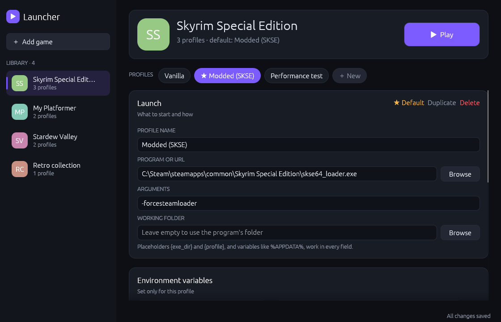

# Launcher

A fast, native desktop launcher for switching between launch profiles of games
you own or are making. Written in Rust with [egui](https://github.com/emilk/egui).



Each game has any number of profiles, and switching is one click. A profile is
two choices:

- **Game folder**: where the game is installed.
- **Repo**: picked from a dropdown of the built-in list, with its instructions
  shown under it.

The launcher fetches the repo itself. The first Play clones it or downloads its
newest release into the launcher's own folder; later Plays start straight away,
with no network. **Update** next to the dropdown fetches it again. How a repo
starts a game is set per repo in [`repos.json`](repos.json), never in the
window.

The ★ profile is the game's default. Changes save automatically.

## Build

Needs [Rust](https://rustup.rs) (stable). [Git](https://git-scm.com) must be on
PATH for repos that are cloned, and a repo whose script builds it from source
needs Rust (or whatever that repo builds with) too.

```
cargo run --release            # open the window
cargo build --release          # target/release/gamelauncher(.exe)
cargo test
```

## Repo list

The list of repos is filled from [`repos.json`](repos.json), which is built
into the program. Each entry looks like this:

```json
{
  "id": "my-tool",
  "name": "My Tool",
  "description": "Script loader that patches the game while it runs",
  "url": "https://github.com/owner/my-tool",
  "method": { "type": "bat", "file": "my-tool.bat", "args": "\"{game_dir}\"" },
  "instructions": "Pick your game folder and press Play."
}
```

- `id`: saved in profiles, so keep it the same once people use it. Must be unique.
- `name`: shown in the dropdown.
- `description`: one line next to the name in the dropdown. Say what the repo
  is, not how it starts — picking a repo is not picking a method. Left out,
  the entry falls back to describing the method.
- `url`: where the repo lives. Required: it is what gets cloned, and where
  releases are looked up. Must be a github.com repo for `copy_and_run`.
- `instructions`: shown under the chosen repo. Use `\n` for new lines.
- `method`: one of the two below.

| Method | Fields | What happens on Play |
| --- | --- | --- |
| `bat` | `file`, `args` (optional) | Clones `url` (shallow), then runs `file` — a script of yours from the [scripts folder](scripts/) — with the clone as the working folder. The script builds the repo if it needs building, and starts the game. |
| `copy_and_run` | `assets` (list), `run`, `args` (optional) | Downloads each name in `assets` from the repo's newest GitHub release, copies them into the game folder, runs `run` from there, and takes them out again when the game closes. |

`assets` and `run` are file names exactly as they appear in the release, not
paths. A release with no file by that name is an error that names what it does
have.

`copy_and_run` leaves the game folder as it found it. A file of the same name
that was already there is set aside as `<name>.launcher-backup` while the game
runs and put back afterwards; the downloaded copy stays in the launcher's own
folder, so the next Play does not download it again. If the launcher is closed
while the game is still running the clean-up is missed, and the backup is left
in place — the next Play restores it rather than overwriting it.

`{game_dir}`, `{repo_dir}` and `{profile}`, and variables like `%APPDATA%` or
`$HOME`, work in `file`, `run` and `args`, and the program gets `GAME_DIR` and
`REPO_DIR` environment variables. `REPO_DIR` is the launcher's folder for that
repo.

To try changes without rebuilding, put your `repos.json` in the settings folder
(see below). It then replaces the built-in list. If it has a mistake, the
launcher says so and uses the built-in list.

## Scripts

Repos that use the `bat` method run a `.bat` **you** wrote. Put it in the
[`scripts/`](scripts/) folder and name it in `repos.json`. The launcher looks
in `%APPDATA%\GameLauncher\scripts\` first, then `scripts\` next to the
program, then this source tree. See [scripts/README.md](scripts/README.md) for
what a script gets and a worked example.

## Command line and shortcuts

```
gamelauncher list
gamelauncher run "My Game"              # default profile, fetching first if needed
gamelauncher run "My Game" "Modded"     # a specific profile
gamelauncher update                     # re-download every repo
gamelauncher update my-tool             # re-download one
```

To make a desktop shortcut for one profile, point it at
`gamelauncher.exe run "My Game" "Modded"`.

## Where settings live

`%APPDATA%\GameLauncher` on Windows, `~/.config/gamelauncher` elsewhere. Set
`GAMELAUNCHER_HOME` to keep it somewhere else, for example next to the launcher
for a portable setup.

| | |
| --- | --- |
| `library.json` | your games and their profiles |
| `repos.json` | your repo list, replacing the built-in one |
| `scripts\` | the `.bat` files for the `bat` method |
| `repos\<repo>\` | what the launcher cloned or downloaded |

A folder under `repos\` is named after the repo's URL, not the entry, so
entries pointing at the same repo share one clone — and one `target` folder
for anything built from source. Deleting one is safe: the next Play fetches it
again. So is interrupting a download: a fetch only counts as finished once the
launcher has written its stamp file.

## Icons

Icons are glyphs from the Fluent icon font Windows ships with: `Segoe Fluent
Icons` on Windows 11, `Segoe MDL2 Assets` on Windows 10. The font is read from
`%WINDIR%\Fonts` at startup, so nothing is bundled and nothing is downloaded.
Without either font every icon falls back to a plain character, so no icon
ever shows up as an empty box.
